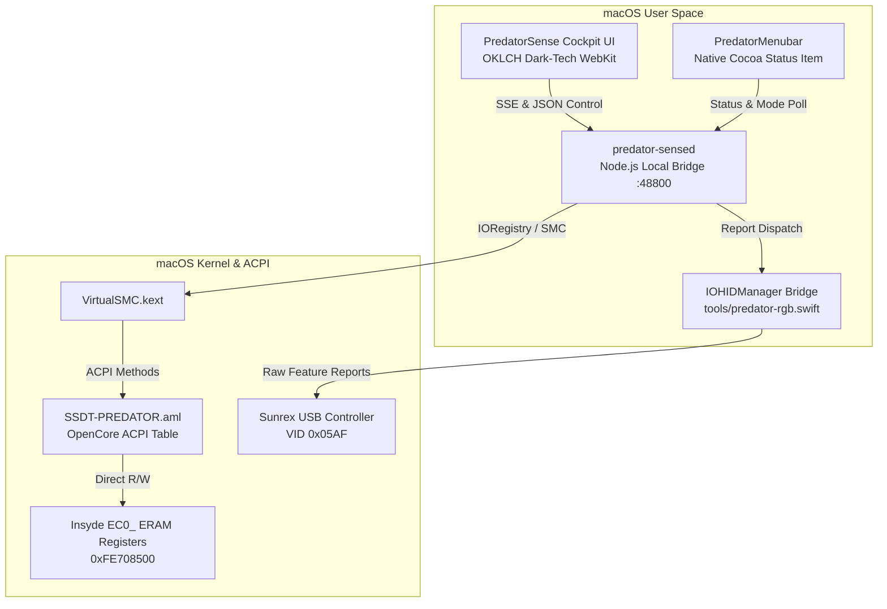

# PredatorSense for macOS

Native hardware control suite, fan manager, 4-zone RGB lighting engine, and telemetry cockpit for **Acer Predator Helios Neo 16 (`PHN16-71`)** running macOS 11+ through **macOS 15 Sequoia**.

Reverse engineered from PredatorSense v5.0.1463 to interface directly with Insyde Embedded Controller hardware and Sunrex USB HID controllers.

[](https://github.com/harshil342/Predator-Sense-for-mac/releases)
[](https://github.com/harshil342/Predator-Sense-for-mac/releases)
[](LICENSE)

---

## Hardware Architecture

| Component | Target Spec | Hardware Control Path |
|---|---|---|
| **Board** | `Compass_RTX` (RPL-HX) | Insyde EC memory-mapped at `0xFE708500` (`ERAM`) |
| **Processor** | Intel Core i7-13700HX (16C/24T) | Sustained PL1 (`0x14`/`0x15`) & Turbo PL2 (`0x16`/`0x17`) |
| **Cooling** | Dual AeroBlade™ 3D Fans | CPU Fan RPM (`0x5C`), GPU Fan RPM (`0x6A`), Fan Mode (`0x54`) |
| **Thermals** | CPU & GPU Sensor Bus | CPU Temp (`0x58` °C), GPU Temp (`0x59` °C), TJMax (`0x54` = 100°C) |
| **Keyboard** | 4-Zone RGB Backlight | Sunrex USB HID (`VID 0x05AF`, UsagePage `0xFF02`) via `IOHIDManager` |
| **Battery** | B1CC Charge Threshold | EC Offset `0xE0` (80% Health Protection Limiter) |
| **Graphics** | NVIDIA RTX 4050 Laptop (6 GB) | NullMoth Metal Driver Telemetry Bridge |

---

## Architecture Overview



---

## Features

### 1. Performance Mode Selector
One-click toggling across five discrete power & fan profiles:
- **Quiet Mode**: Sustained PL1 35W, PL2 45W, silenced fan profile.
- **Balanced Mode**: Sustained PL1 55W, PL2 75W, intelligent dynamic acoustic curve.
- **Performance Mode**: Sustained PL1 75W, PL2 95W, aggressive cooling curve.
- **Turbo Mode**: Maximum unlocked PL1 95W, PL2 115W, fans forced to 100% (5,600 RPM).
- **ECO Mode**: Sustained PL1 25W, PL2 35W, optimized for on-battery longevity.

### 2. CoolBoost™ Dual AeroBlade 3D Fan Dials
- Radial SVG arc velocity gauges and animated rotating fan blade canvas.
- Real-time tachometer readings (RPM) for CPU and GPU fans independently.
- **Auto**, **Max (Turbo)**, or **Custom percentage sliders** (0–100%).

### 3. Sunrex 4-Zone RGB Keyboard Engine
- Interactive 4-zone virtual laptop keyboard silhouette.
- Zone 1 (WASD/Left), Zone 2 (Mid-Left), Zone 3 (Mid-Right), Zone 4 (Numpad).
- Dynamic lighting effects: **Static**, **Breathing**, **Wave**, **Zoom**, **Neon**, **Rain**, and **Spectrum**.
- Preset Predator color palettes or custom Hex/RGB color picker.
- 5-step animation speed and 0–100% brightness attenuation.

### 4. Battery Health Care Limiter
- Toggles the Insyde EC `B1CC` register between 80% and 100%.
- Caps AC charging at 80% to protect the battery from cell degradation during sustained power delivery.

### 5. Native Menubar Companion
- Displays live temperatures and fan speeds directly in the macOS menu bar:
  `⚡ 48°C • 2150 RPM`
- Drop-down menu provides instant one-click performance mode and fan mode switching without opening the main window.

---

## Installation

### Step 1: Install OpenCore ACPI Patch
1. Copy `SSDT-PREDATOR.aml` to your OpenCore EFI:
   ```bash
   cp SSDT-PREDATOR.aml /Volumes/EFI/EFI/OC/ACPI/
   ```
2. Enable `SSDT-PREDATOR.aml` in `/Volumes/EFI/EFI/OC/config.plist` under `ACPI -> Add`:
   ```xml
   <dict>
       <key>Comment</key>
       <string>Acer Predator Helios Neo 16 Hardware Bridge</string>
       <key>Enabled</key>
       <true/>
       <key>Path</key>
       <string>SSDT-PREDATOR.aml</string>
   </dict>
   ```

### Step 2: Install Application
1. Download **`PredatorSense-5.0.1-macOS.dmg`** from [Releases](https://github.com/harshil342/Predator-Sense-for-mac/releases).
2. Double-click the `.dmg` file to mount it.
3. Drag **`PredatorSense.app`** into **`Applications`**.
4. Launch `PredatorSense` from Applications or Spotlight.

See [INSTALL.md](INSTALL.md) for full troubleshooting and build instructions.

---

## Repository Layout

```
.
├── PredatorSense-5.0.1-macOS.dmg  # Standalone Apple Disk Image installer
├── PredatorSense-5.0.1-macOS.zip  # Portable ZIP release with POSIX permissions
├── PredatorSense.app/             # Self-contained macOS Application Bundle
│   └── Contents/
│       ├── Info.plist             # Bundle metadata & bundle identifier
│       ├── MacOS/PredatorSense    # Executable launcher script
│       └── Resources/app/         # Embedded daemon, UI, tools, and ACPI tables
├── SSDT-PREDATOR.dsl              # ACPI Source Table (ASL/AML)
├── SSDT-PREDATOR.aml              # Compiled ACPI binary table (ACPICA 20240827)
├── src/
│   ├── drivers/sunrexKeyboard.ts  # Sunrex USB HID 4-zone RGB driver
│   ├── server/daemon.js           # predator-sensed Node.js hardware bridge
│   └── ui/                        # OKLCH Cyber-Carbon Cockpit UI (HTML/CSS/JS)
├── tools/
│   ├── PredatorMenubar.swift      # Native Cocoa status item companion
│   ├── predator-rgb.swift         # Native macOS IOHIDManager Swift CLI
│   ├── build_dmg.py               # DMG disk image builder
│   └── build_zip.py               # Portable ZIP archive builder
└── tests/
    ├── test_daemon.js             # Daemon integration test
    ├── test_sunrex_keyboard.js    # RGB packet & effect unit tests
    └── verify_all.js              # 13-point end-to-end verification suite
```

---

## License

MIT License. Designed and engineered for the Acer Predator Helios Neo 16 hackintosh community.
